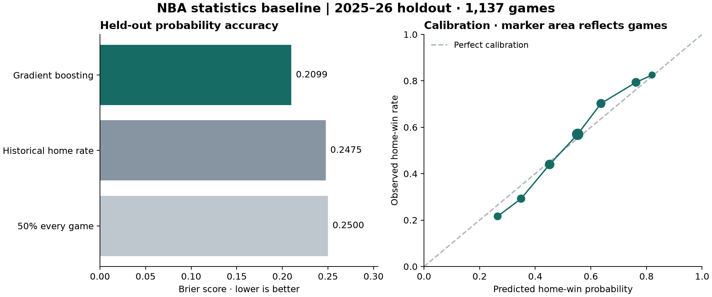

# Gradient-boosting statistics baseline

Held-out Brier score: **0.2099**, versus **0.2475** for the historical home-win-rate reference (15.2% relative reduction).

This is a retrospective statistics-only result. It is not a text-model result or a contamination-cleared LLM benchmark.

## Protocol

- Source: 3,621 checksum-verified historical regular-season results, through April 10 in each season. No additional network requests.
- Eligibility: both teams have at least 5 previous games in the same season; 246 warmup games excluded.
- Prediction cutoff: 60 minutes before the retrieved scheduled start. Features use only earlier ET calendar dates in the same season.
- Features: prior-game count, season win rate, last-five win rate, last-five average point differential, rest days and back-to-back status, for each side and home-minus-away differences (18 numeric features).
- Model selection: four predetermined shallow gradient-boosting classifiers, selected by validation Brier score. No random splits, internal early stopping, post-hoc probability calibration or test-driven tuning.
- Final fit: training plus validation seasons, with the selected parameters fixed. The historical-rate reference also uses only these fitted seasons.
- During the test season, earlier completed test games update rolling features. Their outcomes are available before later predictions; the model itself is not refitted.
- No injury text, narratives, current standings, odds, player data, team identifiers or target-game outcomes enter the feature matrix.

| Role | Season | Games | First game | Last game |
| --- | --- | ---: | --- | --- |
| train | 2023–24 | 1115 | 2023-11-03 | 2024-04-10 |
| validation | 2024–25 | 1123 | 2024-11-01 | 2025-04-10 |
| test | 2025–26 | 1137 | 2025-10-31 | 2026-04-10 |

## Validation model selection

| Depth | Trees | Brier | Log loss | ROC AUC | Accuracy |
| ---: | ---: | ---: | ---: | ---: | ---: |
| 1 | 100 | 0.2169 | 0.6230 | 0.7030 | 64.9% |
| 1 | 200 | 0.2174 | 0.6244 | 0.7017 | 65.1% |
| 2 | 100 | 0.2174 | 0.6249 | 0.7025 | 64.2% |
| 2 | 200 | 0.2187 | 0.6288 | 0.7012 | 64.5% |

Selected parameters: `{"learning_rate": 0.05, "loss": "log_loss", "max_depth": 1, "min_samples_leaf": 20, "n_estimators": 100, "n_iter_no_change": null, "random_state": 230, "subsample": 1.0}`.

## Held-out test results

| Model | Brier ↓ | Log loss ↓ | ROC AUC ↑ | Accuracy ↑ |
| --- | ---: | ---: | ---: | ---: |
| gradient_boosting | 0.2099 | 0.6085 | 0.7312 | 67.3% |
| historical_home_rate | 0.2475 | 0.6882 | 0.5000 | 55.0% |
| constant_50_percent | 0.2500 | 0.6931 | 0.5000 | 55.0% |

Gradient-boosting Brier 95% interval: **[0.2008, 0.2190]**. Paired Brier difference (boosting minus historical rate): **[-0.0465, -0.0286]**; negative favors boosting.
Intervals use 2,000 paired bootstrap resamples of 154 ET game dates. Conditional on this fitted model and season; does not capture training uncertainty or serial dependence across days.

Test home-win frequency: 55.0%. Historical-rate prediction: 54.6%. Accuracy uses a fixed 0.5 threshold; ties predict home.



## Limits and next use

The five-game warmup excludes season openers, and coverage ends April 10 rather than including every regular-season game. Scheduled starts were retrieved retrospectively; rescheduling and exact historical result-availability times are not independently archived. Previous-date results are used conservatively, but unusual delayed completion remains a limitation.

The test season has now been examined for this baseline. Future model comparisons should preserve this protocol and disclose repeated evaluation; choose a later untouched period after the eventual language model's training cutoff for the final LLM benchmark. Narrative/injury experiments must compare all models on exactly the same eligible games, not compare their small text sample directly with this larger statistics cohort.

## Reproduce

```bash
uv pip install --python .venv/bin/python --group local
.venv/bin/python scripts/run_gradient_boosting.py
.venv/bin/python scripts/validate_gradient_boosting.py
.venv/bin/python -m unittest discover -s tests -v
```

Model, separated inputs/labels, split membership and validation/test predictions are under `data/processed/gradient_boosting/` (git-ignored). Configuration, source/code hashes, library versions and full-precision metrics are in `metrics.json`; calibration bins are in `calibration.csv`.

Implementation references: [scikit-learn gradient boosting](https://scikit-learn.org/stable/modules/generated/sklearn.ensemble.GradientBoostingClassifier.html), [binary Brier score](https://scikit-learn.org/stable/modules/generated/sklearn.metrics.brier_score_loss.html), and [data leakage guidance](https://scikit-learn.org/stable/common_pitfalls.html#data-leakage).
